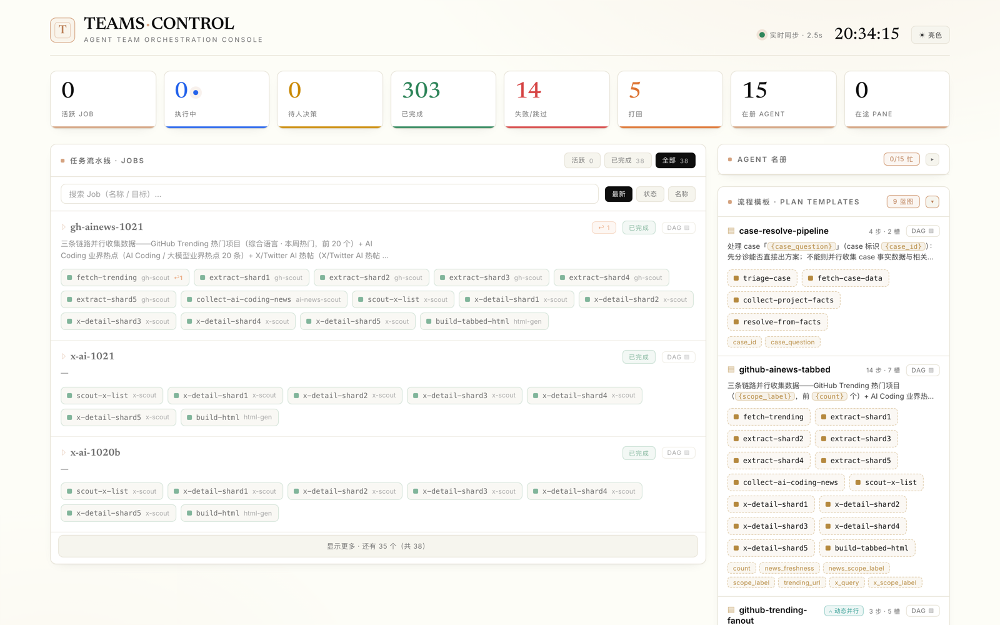
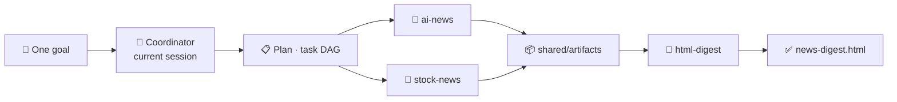

<div align="center">

# 🤖 Agent Team (TEAMS)

**Turn one goal into a task DAG — and let a team of AI agents run it in parallel.**

A multi-agent orchestration framework built on [herdr](https://herdr.dev). Your current session *is* the coordinator.

English · [简体中文](README.md)

[](https://www.python.org/)
[](https://herdr.dev)
[](pyproject.toml)
[](agent_team/cli.py)

[Quick Start](#quick-start) · [Features](#features) · [How it works](#how-it-works) · [Project layout](#project-layout) · [CLI](#cli) · [Development](#development)

</div>

---



<p align="center"><sub>The live dashboard: job pipeline, per-job DAG, agent roster, and reusable plan templates (example data).</sub></p>

## Quick Start

**Requirements:** Python 3.11+, [uv](https://github.com/astral-sh/uv), [herdr](https://herdr.dev)

```bash
git clone https://github.com/jingpeng3/MyTeam.git
cd MyTeam

brew install herdr          # macOS; see herdr.dev for other platforms
uv run team dashboard       # open http://127.0.0.1:8787
```

Then open this directory in herdr / Claude Code and simply talk to it — no commands to memorize:

> 🗣️ “Build me a team that searches AI news and stock news, then merges both into a single HTML digest.”

The agent clarifies the goal, designs the DAG, creates the workers, and dry-runs the plan before spawning anything for real.

## Features

| | Feature | What it gives you |
|---|---|---|
| 🧩 | **Declarative agents** | An agent is just a directory plus an `agent.yaml` manifest: identity, runtime, capability tags, concurrency limit. One registry manages them all. |
| ⚡ | **On-demand workers** | The coordinator stays resident; workers are spawned into herdr panes only when there is work and recycled as soon as they finish. |
| 🎯 | **Capability routing** | Tasks declare what they need; the scheduler matches them to agents by capability. No match means the task waits — never a mis-dispatch. |
| 🌿 | **Parallel DAG** | Independent nodes are dispatched in the same tick. `fanout` templates expand into shards at runtime based on upstream output. |
| 🗂 | **Isolated jobs** | One goal, one Job. State, results, and artifacts are fully isolated, and multiple Jobs can run side by side. |
| 🧬 | **Reusable plan templates** | Keep the orchestration skeleton fixed and leave goals or stage descriptions as `{{slots}}`. One template can be instantiated many times concurrently. |
| 📦 | **Shared artifacts, opt-in inheritance** | Cross-task artifacts live under the Job directory. Downstream nodes declare `see_artifacts` and the framework hands them the exact upstream files. |
| 🛡 | **Retry · skip · reject** | Failed tasks retry automatically; unnecessary steps can be bypassed; a reviewer can send work back upstream with feedback accumulated as evidence. |
| 💬 | **Human in the loop** | A worker that needs a decision pauses and asks; the coordinator relays the answer back into the same session. |
| 📊 | **Live dashboard** | Visualize every Job's DAG, node status, artifacts, reject history, agent load, and plan templates — all locally. |

## How it works



| Phase | Command | What happens |
|---|---|---|
| **Plan** | `team-build` / `team plan` | Split the goal into a DAG. Nodes declare `needs` (dependencies) and `capabilities`. |
| **Dispatch** | `team tick` | Every ready node (all dependencies satisfied) is dispatched to a matching worker in parallel. |
| **Execute** | worker | Each task runs in its own isolated cwd; artifacts go to the Job's artifacts directory. |
| **Converge** | `team monitor` | Only outbox signals count. Panes are recycled, downstream nodes unlocked, retries and rejects handled. |
| **Deliver** | `team report` | Summaries, timings, and artifact paths for every task. |

The coordinator never guesses what a worker printed in its terminal — **everything is driven by durable on-disk signals**, so an interrupted run can resume from file state.

## Project layout

```text
team.yaml                 team registry + global runtime defaults
coordinator/
  prompt.md               coordinator responsibilities
  plans/                  plan templates / per-goal DAGs
    vars/                 --vars-file values (git-ignored)
  state/                  jobs/<goal_id>.json, task board, runtime pane map
agents/<name>/
  agent.yaml              manifest (identity / runtime / capabilities / concurrency)
  prompt.md               the agent's persona
  workspace/              base workspace (read-only reference)
    <goal>__<task>/       per-task cwd, removed when the task finishes
  inbox/  outbox/         task signals / result signals
shared/artifacts/         cross-agent artifacts (namespaced by goal_id)
agent_team/               core Python package
tests/                    pytest suite
docs/images/              static assets for the README
```

## Install the team CLI

Skills and the coordinator invoke the CLI as `uv run team …` from the repo root. uv creates `.venv` on first run and always executes this repo's code — no global install required.

To install a global `team` command:

```bash
scripts/install.sh           # install / reinstall the CLI (idempotent)
scripts/install.sh --dev     # also create a dev .venv (pytest / ruff)
scripts/install.sh --uninstall
```

The script uses `uv tool install --editable .` (falling back to pipx) to create a dedicated environment and put `team` on `~/.local/bin`, then verifies PATH and herdr. It deliberately avoids `pip install`: Homebrew and other system Pythons are externally managed (PEP 668) and will reject it. Editable installs pick up code changes immediately; re-run the script after changing dependencies or entry points in `pyproject.toml`.

> [!NOTE]
> The package is also named `agent-team`. A global install replaces any `team` command previously installed from another checkout.

**Runtime dependency:** PyYAML only (pinned in `pyproject.toml`). Everything else is standard library.

## CLI

The `team` CLI is the engine behind the skills, so you rarely type it by hand. When you do, run it from the repo root as `uv run team …`.

| Group | Command | Purpose |
|---|---|---|
| Plan | `agent` | Create / inspect / remove agents |
| Plan | `plan` | Load a DAG as a Job; supports `{{slots}}` templates and `--as` instances |
| Dispatch | `tick` | Run one scheduling round and dispatch every ready node |
| Dispatch | `monitor` | Scan outboxes, settle completions, unlock downstream, handle retries |
| Dispatch | `run` | Loop tick + monitor until the Job completes or gets stuck |
| Intervene | `skip` | Bypass a step that no longer needs to run; downstream continues |
| Intervene | `retask` | Rewrite the goal of a not-yet-dispatched downstream step |
| Intervene | `answer` | Answer a worker's question so it can continue |
| Intervene | `reject` | Send a step and all its descendants back for rework with feedback |
| Intervene | `expand` | Expand a fan-out template node into K parallel subtasks |
| Inspect | `jobs` / `status` / `report` | List Jobs, inspect a Job, print the final report |
| Inspect | `dashboard` | Start the local live dashboard (defaults to `127.0.0.1:8787`, no auth) |
| Manage | `job` | Remove a Job (artifacts are kept by default) |

Scheduling commands accept `--dry-run`: they write signals without spawning workers, which is handy for validating a plan.

## Talk to your agents

Three built-in skills in `.claude/skills/` cover the full loop:

| Skill | Trigger | Responsibility |
|---|---|---|
| `team-build` | “Build a team / orchestrate X” | Clarify the goal → create agents → write a plan → dry-run |
| `agent-create` | “Create / add an agent” | Create a single agent interactively and register it |
| `team-run` | “Run it / keep going / let the team work” | Drive tick + monitor to completion and report |

## Plan templates

A plan is a Job. Nodes declare dependencies, required capabilities, and which upstream artifacts they consume:

```json
{
  "goal_id": "baidu-news-digest",
  "goal": "Search Baidu News for {{report_date}} and build an HTML digest",
  "tasks": [
    {"task_id": "ai-news",    "capabilities": ["ai-news"],    "needs": []},
    {"task_id": "stock-news", "capabilities": ["stock-news"], "needs": []},
    {"task_id": "merge-html", "capabilities": ["html-report"],
     "needs": ["ai-news", "stock-news"],
     "see_artifacts": ["ai-news", "stock-news"]}
  ]
}
```

```bash
uv run team plan coordinator/plans/baidu-news-digest.json --show-vars
uv run team plan coordinator/plans/baidu-news-digest.json \
  --as news-2026-10-21 --var report_date=2026-10-21
```

Missing slots, dangling dependencies, cycles, or invalid `see_artifacts` / `reject_to` references are rejected at load time — a half-baked goal never reaches a worker.

## Worker completion protocol

Workers read `inbox/<goal_id>__<task_id>.json` and write structured results to `outbox/<goal_id>__<task_id>.json`:

```json
{
  "task_id": "merge-html",
  "status": "done",
  "summary": "Merged 20 stories into a single-file HTML digest",
  "artifacts": ["/abs/path/to/news-digest.html"],
  "error": null
}
```

- `status`: `done` / `failed`. Reviewer nodes may emit `reject` to send upstream work back.
- Add `"retryable": false` for permanent failures to skip pointless retries.
- The coordinator only trusts this structured result and never parses free-form terminal output.

## Development

```bash
uv run --extra dev pytest        # run the test suite
uv run --extra dev ruff check    # lint
```

## Known limitations

- `agent create` / `agent remove` rewrite `team.yaml` with PyYAML and **drop comments** (structure and values are preserved). Use ruamel.yaml if comment preservation matters.
- The herdr `tab create` pane_id extraction uses a deep-search fallback; verify the returned shape in your environment.

---

<p align="center"><sub>TEAMS · Orchestrate agent teams like a pipeline.</sub></p>
