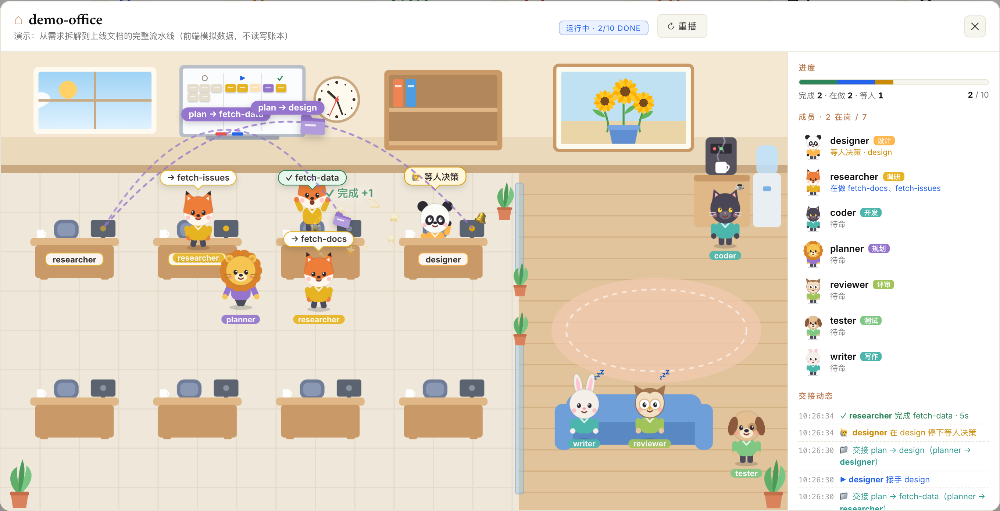
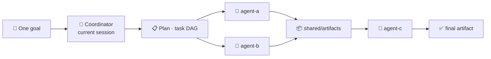

<div align="center">

# 🤖 Agent Team (TEAMS)

**Turn one goal into a task DAG — and let a team of AI agents run it in parallel.**

A multi-agent orchestration framework built on [herdr](https://herdr.dev). Your current session *is* the coordinator.

English · [简体中文](README.md)

[](https://www.python.org/)
[](https://herdr.dev)
[](pyproject.toml)
[](agent_team/cli.py)

[Quick Start](#quick-start) · [Features](#features) · [How it works](#how-it-works) · [Project layout](#project-layout) · [CLI](#cli) · [Development](#development)

</div>

---


<p align="center"><sub>The live dashboard: job pipeline, per-job DAG, agent roster, and reusable plan templates (example data).</sub></p>

<p align="center">
  <video src="https://github.com/user-attachments/assets/1b53cbf3-7750-446b-a3b9-35708019d7a1" controls preload="metadata" width="880"></video>
</p>

<p align="center"><sub>▶ Product intro video (53s) · <a href="https://github.com/user-attachments/assets/1b53cbf3-7750-446b-a3b9-35708019d7a1">Open in browser</a> · <a href="docs/videos/teams-control-intro.mp4">Download</a> · <a href="docs/images/teams-control-intro.jpg">Cover image</a></sub></p>

[](docs/videos/office-demo.mp4)

<p align="center"><sub>The office view: a running job becomes an office where agents pick up tasks, hand off work, wait for decisions, get rejected, and celebrate when everything is done · ▶ Demo recording (59s): click the screenshot or <a href="https://cdn.jsdelivr.net/gh/jingpeng3/MyTeam@main/docs/videos/office-demo.mp4">open in browser</a> · <a href="docs/videos/office-demo.mp4">Download</a> · open <code>/?demo=office</code> locally to replay</sub></p>

## Quick Start

### 1. Install the prerequisites

| Dependency | Used for | Install |
|---|---|---|
| [uv](https://docs.astral.sh/uv/) | Manages Python and the virtualenv, runs the `team` CLI | `brew install uv`, or `curl -LsSf https://astral.sh/uv/install.sh \| sh` |
| Python 3.11+ | Runs the framework | uv downloads one automatically if none is found; or run `uv python install 3.11` |
| [herdr](https://herdr.dev) | Opens panes for workers and manages their lifecycle | `brew install herdr`, or `curl -fsSL https://herdr.dev/install.sh \| sh` ([other methods](https://herdr.dev/docs/install/)) |
| [Claude Code](https://docs.anthropic.com/en/docs/claude-code) | Default runtime for the coordinator session and workers (`cli: claude` in `team.yaml`) | Install per the official docs, then run `claude` once to log in |

### 2. Clone and self-check

```bash
git clone https://github.com/jingpeng3/MyTeam.git
cd MyTeam

herdr --version
claude --version
uv run team agent list      # first run creates .venv and installs deps; printing the agent list means success
```

**You don't need to create a Python virtualenv yourself.** On its first run, `uv run` creates `.venv` in the repo root from `uv.lock` and installs the dependencies, and it re-syncs automatically when they change. To install ahead of time, run `uv sync` (or `uv sync --extra dev` for dev tools).

> [!TIP]
> On a corporate network or with slow PyPI access, point uv at a mirror first, e.g. `export UV_DEFAULT_INDEX=https://<your-mirror>/simple`, or set it in `~/.config/uv/uv.toml`. If uv can't download Python, use one you already have: `uv run --python /path/to/python3.11 team agent list`.

### 3. Start the coordinator session

```bash
herdr                       # enter herdr (starts the background server automatically)
# inside a herdr pane:
cd /path/to/MyTeam
claude                      # this session is the coordinator
```

- Start `claude` from the **repo root**: the `team-build` / `team-run` skills live in the project-level `.claude/skills/` and won't trigger from another directory.
- Start it **inside a herdr pane** if you can: the framework uses the `HERDR_PANE_ID` / `HERDR_SESSION` variables herdr injects to recognize the coordinator's own pane (so it is never recycled) and to keep workers in the same session. Outside herdr, workers land in the `default` session.

Then simply talk to it — no commands to memorize:

> 🗣️ “Build me a team that collects sources A and B in parallel, then merges both into a single HTML report.”

The agent clarifies the goal, designs the DAG, creates the workers, and dry-runs the plan before spawning anything for real.

### 4. Open the dashboard (optional)

```bash
uv run team dashboard       # open http://127.0.0.1:8787
```

> [!WARNING]
> Workers run with `--dangerously-skip-permissions` by default (see `defaults.runtime.flags` in `team.yaml`), so they read and write files and run commands without asking. To turn it off, remove the flag from `team.yaml`, or give a single agent a **non-empty** `runtime.flags` list in its `agent.yaml` to replace the default (`flags: []` has no effect; empty values fall back to the team default).

## Features

| | Feature | What it gives you |
|---|---|---|
| 🧩 | **Declarative agents** | An agent is just a directory plus an `agent.yaml` manifest: identity, runtime, capability tags, concurrency limit. One registry manages them all. |
| ⚡ | **On-demand workers** | The coordinator stays resident; workers are spawned into herdr panes only when there is work and recycled as soon as they finish. |
| 🎯 | **Capability routing** | Tasks declare what they need; the scheduler matches them to agents by capability. No match means the task waits — never a mis-dispatch. |
| 🌿 | **Parallel DAG** | Independent nodes are dispatched in the same tick. `fanout` templates expand into shards at runtime based on upstream output. |
| 🗂 | **Isolated jobs** | One goal, one Job. State, results, and artifacts are fully isolated, and multiple Jobs can run side by side. |
| 🧬 | **Reusable plan templates** | Keep the orchestration skeleton fixed and leave goals or stage descriptions as `{{slots}}`. One template can be instantiated many times concurrently. |
| 📦 | **Shared artifacts, opt-in inheritance** | Cross-task artifacts live under the Job directory. Downstream nodes declare `see_artifacts` and the framework hands them the exact upstream files. |
| 🛡 | **Retry · skip · reject** | Failed tasks retry automatically; unnecessary steps can be bypassed; a reviewer can send work back upstream with feedback accumulated as evidence. |
| 💬 | **Human in the loop** | A worker that needs a decision pauses and asks; the coordinator relays the answer back into the same session. |
| 🔁 | **Event-driven waiting** | `wait` harvests every 3s and returns the moment any in-flight task delivers, fails, is rejected, or asks for input; a background `watch` keeps harvesting, timing out, and recycling panes while you are away. |
| 🧠 | **Automatic retrospectives** | Opt-in: a settled Job spawns a retro Job that analyses the run and files suggestions in `coordinator/insights/backlog.json`, which `team-evolve` picks up. |
| 📊 | **Live dashboard** | Visualize every Job's DAG, node status, artifacts, reject history, agent load, and plan templates — all locally. |

## How it works



| Phase | Command | What happens |
|---|---|---|
| **Plan** | `team-build` / `team plan` | Split the goal into a DAG. Nodes declare `needs` (dependencies) and `capabilities`. |
| **Dispatch** | `team tick` | Every ready node (all dependencies satisfied) is dispatched to a matching worker in parallel. |
| **Execute** | worker | Each task runs in its own isolated cwd; artifacts go to the Job's artifacts directory. |
| **Converge** | `team wait` | Only outbox signals count. Panes are recycled, downstream nodes unlocked, retries and rejects handled — returning as soon as any in-flight task changes. |
| **Deliver** | `team report` | Summaries, timings, and artifact paths for every task. |

The coordinator never guesses what a worker printed in its terminal — **everything is driven by durable on-disk signals**, so an interrupted run can resume from file state.

## Project layout

```text
team.yaml                 team registry + global runtime defaults
coordinator/
  prompt.md               coordinator responsibilities
  plans/                  plan templates / per-goal DAGs
    vars/                 --vars-file values (git-ignored)
  state/                  jobs/<goal_id>.json, task board, runtime pane map
agents/<name>/
  agent.yaml              manifest (identity / runtime / capabilities / concurrency)
  prompt.md               the agent's persona
  workspace/              base workspace (read-only reference)
    <goal>__<task>/       per-task cwd, removed when the task finishes
  inbox/  outbox/         task signals / result signals
shared/artifacts/         cross-agent artifacts (namespaced by goal_id)
agent_team/               core Python package
tests/                    pytest suite
docs/images/              static assets for the README
docs/videos/              product intro video for the README
```

## Install the team CLI

**You can skip this if you follow Quick Start.** Skills and the coordinator invoke the CLI as `uv run team …` from the repo root. uv creates `.venv` on first run and always executes this repo's code — no global install required.

If you want to type `team` from any directory, install it as a global command:

```bash
scripts/install.sh           # install / reinstall the CLI (idempotent)
scripts/install.sh --dev     # also create a dev .venv (pytest / ruff)
scripts/install.sh --uninstall
```

The script uses `uv tool install --editable .` (falling back to pipx) to create a dedicated environment and put `team` on `~/.local/bin`, then verifies PATH and herdr. It deliberately avoids `pip install`: Homebrew and other system Pythons are externally managed (PEP 668) and will reject it. Editable installs pick up code changes immediately; re-run the script after changing dependencies or entry points in `pyproject.toml` (the in-repo `.venv` is re-synced by `uv run` on its own).

If `~/.local/bin` is not on your PATH, the script says so and exits. Add `export PATH="$HOME/.local/bin:$PATH"` to your shell config (e.g. `~/.zshrc`) and open a new terminal.

> [!NOTE]
> The package is also named `agent-team`. A global install replaces any `team` command previously installed from another checkout.

**Runtime dependency:** PyYAML only (pinned in `pyproject.toml`). Everything else is standard library.

## CLI

The `team` CLI is the engine behind the skills, so you rarely type it by hand. When you do, run it from the repo root as `uv run team …`.

| Group | Command | Purpose |
|---|---|---|
| Plan | `agent` | Create / inspect / remove agents |
| Plan | `plan` | Load a DAG as a Job; supports `{{slots}}` templates and `--as` instances |
| Dispatch | `tick` | Run one scheduling round and dispatch every ready node; newly unlocked downstream nodes are `held` so you can retask/skip first |
| Dispatch | `wait` | Block until an in-flight task changes (done/failed/awaiting input), harvest only — replaces sleep+monitor |
| Dispatch | `monitor` | Scan outboxes once, settle completions, unlock downstream, handle retries |
| Dispatch | `watch` | Background harvester (auto-spawned by tick): harvests outboxes, enforces timeouts, recycles panes while you are away — never dispatches |
| Dispatch | `run` | Loop tick + monitor until the Job completes or gets stuck |
| Intervene | `skip` | Bypass a step that no longer needs to run; downstream continues |
| Intervene | `retask` | Rewrite the goal of a not-yet-dispatched downstream step |
| Intervene | `answer` | Answer a worker's question so it can continue |
| Intervene | `reject` | Send a step and all its descendants back for rework with feedback |
| Intervene | `expand` | Expand a fan-out template node into K parallel subtasks |
| Inspect | `jobs` / `status` / `report` | List Jobs, inspect a Job, print the final report |
| Inspect | `dashboard` | Start the local live dashboard (defaults to `127.0.0.1:8787`, no auth) |
| Retro | `retro` | `status` / `on` / `off` for retro switches; `run <goal_id>` spawns a retro Job manually |
| Retro | `insights` | List / show / mark the optimisation suggestions collected from retrospectives |
| Manage | `job` | Remove a Job (artifacts are kept by default) |

Scheduling commands accept `--dry-run`: they write signals without spawning workers, which is handy for validating a plan.

## Talk to your agents

Four built-in framework skills in `.claude/skills/` cover the full loop, including self-improvement (`find-skills` in the same directory is a generic skill-search tool, not part of the framework flow):

| Skill | Trigger | Responsibility |
|---|---|---|
| `team-build` | “Build a team / orchestrate X” | Clarify the goal → create agents → write a plan → dry-run |
| `agent-create` | “Create / add an agent” | Create a single agent interactively and register it |
| `team-run` | “Run it / keep going / let the team work” | Drive tick + wait to completion and report |
| `team-evolve` | “Improve the project / review retro suggestions” | Pick high-value suggestions from the retro backlog, verify and apply them, mark as applied |

## Plan templates

A plan is a Job. Nodes declare dependencies, required capabilities, and which upstream artifacts they consume:

```json
{
  "goal_id": "example-pipeline",
  "goal": "Collect sources A and B in parallel and merge them into one report",
  "tasks": [
    {"task_id": "collect-a", "capabilities": ["collect"], "needs": []},
    {"task_id": "collect-b", "capabilities": ["collect"], "needs": []},
    {"task_id": "merge",    "capabilities": ["report"],
     "needs": ["collect-a", "collect-b"],
     "see_artifacts": ["collect-a", "collect-b"]}
  ]
}
```

```bash
uv run team plan coordinator/plans/<your-template>.json --show-vars   # list the slots
uv run team plan coordinator/plans/<your-template>.json \
  --as <batch-id> --var <slot>=<value>
```

Missing slots, dangling dependencies, cycles, or invalid `see_artifacts` / `reject_to` references are rejected at load time — a half-baked goal never reaches a worker.

## Worker completion protocol

The generic delivery protocol (read the inbox, write the outbox, artifact directory, human-in-the-loop) lives in `agent_team/worker_protocol.md` and is injected into the bootstrap prompt by the framework — each agent's `prompt.md` only describes its own role.

Workers read `inbox/<goal_id>__<task_id>.json` and write structured results to `outbox/<goal_id>__<task_id>.json`:

```json
{
  "task_id": "merge-html",
  "status": "done",
  "summary": "Merged 20 stories into a single-file HTML digest",
  "artifacts": ["/abs/path/to/news-digest.html"],
  "error": null
}
```

- `status`: `done` / `failed`. Reviewer nodes may emit `reject` to send upstream work back.
- Add `"retryable": false` for permanent failures to skip pointless retries.
- The coordinator only trusts this structured result and never parses free-form terminal output.

## Development

```bash
uv run --extra dev pytest        # run the test suite
uv run --extra dev ruff check    # lint
```

## Known limitations

- `agent create` / `agent remove` rewrite `team.yaml` with PyYAML and **drop comments** (structure and values are preserved). Use ruamel.yaml if comment preservation matters.
- The herdr `tab create` pane_id extraction uses a deep-search fallback; verify the returned shape in your environment.

---

<p align="center"><sub>TEAMS · Orchestrate agent teams like a pipeline.</sub></p>
