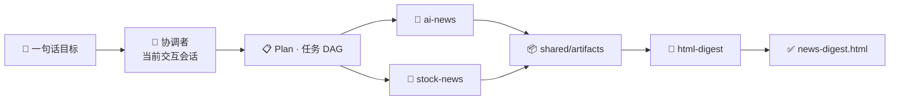

<div align="center">

# 🤖 Agent Team (TEAMS)

**把一句话目标拆成任务 DAG，让多个 AI agent 并行干活**

基于 [herdr](https://herdr.dev) 的多 agent 团队编排框架 · 当前交互会话就是协调者

[English](README.en.md) · 简体中文

[](https://www.python.org/)
[](https://herdr.dev)
[](pyproject.toml)
[](agent_team/cli.py)

[快速开始](#快速开始) · [核心特性](#核心特性) · [工作原理](#工作原理) · [目录结构](#目录结构) · [CLI](#cli) · [开发](#开发)

</div>

---


<p align="center"><sub>实时看板：任务流水线、每个 Job 的 DAG、Agent 名册与可复用流程模板（示例数据）</sub></p>

## 快速开始

**前置条件**：Python 3.11+、[uv](https://github.com/astral-sh/uv)、[herdr](https://herdr.dev)

```bash
git clone https://github.com/jingpeng3/MyTeam.git
cd MyTeam

brew install herdr          # macOS；其他平台见 herdr.dev
uv run team dashboard       # 打开 http://127.0.0.1:8787
```

然后在 herdr / Claude Code 中打开本目录，直接对话即可，不用记命令：

> 🗣️ 「建个团队，帮我编排一个『搜索 AI 新闻 + 股票新闻 → 合并生成 HTML 简报』的流程」

agent 会先澄清需求、规划 DAG、创建 agent 并 dry-run，确认后再真正拉起 worker 执行。

## 核心特性

| | 特性 | 说明 |
|---|---|---|
| 🧩 | **声明式 Agent** | 每个 agent 就是一个目录 + 一份 `agent.yaml`，声明身份、运行时、能力标签与并发上限，注册表统一管理。 |
| ⚡ | **按需拉起，用完即收** | 协调者常驻，worker 只在有任务时被拉进 herdr pane，干完立即回收，不占后台资源。 |
| 🎯 | **能力路由** | 任务只声明所需能力，调度器按能力精确匹配 agent；找不到合适的人就排队，绝不误派。 |
| 🌿 | **并行 DAG** | 没有依赖关系的节点同一轮并发派发；`fanout` 模板还能按运行期数据动态展开分片。 |
| 🗂 | **多 Job 隔离** | 一个目标一个 Job，状态、结果、产物完全隔离，多个 Job 可同时推进、互不覆盖。 |
| 🧬 | **可复用流程模板** | 编排骨架固定，目标与阶段描述留成 `{{槽}}`；同一模板可实例化多个批次并发运行。 |
| 📦 | **产物共享与按需继承** | 跨任务产物按 Job 集中存放；下游显式声明 `see_artifacts`，框架自动把上游文件递给它。 |
| 🛡 | **重试 · 跳过 · 打回** | 失败自动重试；无需执行的步骤可绕过；评审不合格可打回上游连同后代重跑，并注入历史意见。 |
| 💬 | **人机协作** | worker 遇到需要拍板的点会停下来提问，协调者把答复回注后它继续执行。 |
| 🔁 | **事件驱动等待** | `wait` 每 3s 收割一次，任一在途任务交付/失败/打回/等人就立即返回；后台 `watch` 在协调者离开时继续收割、判超时、回收 pane。 |
| 🧠 | **流程自动复盘** | 可选开关：Job 收敛后自动拉一个复盘 Job 分析执行过程，建议沉淀进 `coordinator/insights/backlog.json`，由 `team-evolve` 挑选落地。 |
| 📊 | **实时看板** | 本机可视化各 Job 的 DAG、节点状态、产物、打回记录、Agent 负载与流程模板。 |

## 工作原理



| 阶段 | 命令 | 做什么 |
|---|---|---|
| **编排** | `team-build` / `team plan` | 把目标拆成 DAG，节点声明 `needs`（依赖）与 `capabilities`（能力）。 |
| **派发** | `team tick` | 所有依赖已满足的 ready 节点按能力并发派给 worker。 |
| **执行** | worker | 每个任务在自己的独占 cwd 里执行，产物写入 Job 的 artifacts 目录。 |
| **收敛** | `team wait` | 只认 worker 写回的 outbox 信号，回收 pane、解锁下游、按需重试或打回；在途任务一有变化立即返回。 |
| **交付** | `team report` | 汇总每个任务的摘要、耗时与产物路径。 |

协调者不去猜 worker 终端里输出了什么——**一切以落盘的信号为准**，所以进程中断后也能从文件状态恢复。

## 目录结构

```text
team.yaml                 团队注册表 + 全局默认运行时
coordinator/
  prompt.md               协调者职责说明
  plans/                  Plan 模板 / 每个目标的 DAG
    vars/                 --vars-file 填槽值（git 忽略）
  state/                  jobs/<goal_id>.json、task-board、runtime pane 映射
agents/<name>/
  agent.yaml              manifest（身份 / 运行时 / capabilities / 并发）
  prompt.md               该 agent 的 persona
  workspace/              基座工作目录（只读参考）
    <goal>__<task>/       worker 本任务独占 cwd，任务结束即清
  inbox/  outbox/         任务信号 / 结果信号
shared/artifacts/         跨 agent 共享产物（按 goal_id 分子目录）
agent_team/               核心 Python 包
tests/                    pytest 用例
docs/images/              README 截图等静态资源
```

## 安装 team CLI

skill 与协调者都在仓库根用 `uv run team …` 调用 CLI：uv 首次运行会自动建 `.venv` 并装好本仓库，跑的始终是本仓库代码，不依赖全局安装。

如果想把 `team` 装成全局命令：

```bash
scripts/install.sh           # 安装 / 重装 team CLI（可重复执行）
scripts/install.sh --dev     # 另建开发环境 .venv（pytest / ruff）
scripts/install.sh --uninstall
```

脚本用 `uv tool install --editable .`（没有 uv 时退回 pipx）为 CLI 建独立环境，把 `team` 装到 `~/.local/bin`，装完自检 PATH 与 herdr。不用 `pip install`：Homebrew 等系统 Python 是 externally-managed（PEP 668），直接装会被拒。editable 安装下改代码即时生效；改了 `pyproject.toml` 的依赖或入口后重跑一次脚本即可。

> [!NOTE]
> 包名同为 `agent-team`。全局安装会覆盖其他仓库此前安装的 `team` 命令。

**运行时依赖**：PyYAML（唯一第三方依赖，版本钉在 `pyproject.toml`），其余全部使用标准库。

## CLI

底层 `team` CLI 是 skill 使用的引擎，一般不用手动敲；需要时在仓库根用 `uv run team …` 调用。

| 分组 | 命令 | 作用 |
|---|---|---|
| 编排 | `agent` | 创建 / 查看 / 移除 agent |
| 编排 | `plan` | 载入一个 DAG 为 Job；支持 `{{槽}}` 模板与 `--as` 多实例 |
| 调度 | `tick` | 调度一轮，派发所有 ready 节点；本轮刚解锁的下游默认 `held`，留给你先 retask/skip |
| 调度 | `wait` | 阻塞到在途任务有变化（交付/失败/等人）立即返回，只收割不分派；逐轮驱动用它代替 sleep+monitor |
| 调度 | `monitor` | 扫描 outbox，收敛完成、解锁下游、处理重试 |
| 调度 | `watch` | 后台收割守护（tick 自动拉起）：协调者不在场时也收割 outbox、判超时、回收 pane，从不分派 |
| 调度 | `run` | 自动循环 tick + monitor 直到完成或卡死 |
| 干预 | `skip` | 主动绕过无需执行的步骤，下游照常进行 |
| 干预 | `retask` | 根据上游结果改写尚未派发的下游 goal |
| 干预 | `answer` | 回答 worker 的提问，让它继续执行 |
| 干预 | `reject` | 打回某步及其全部后代重跑，并注入打回意见 |
| 干预 | `expand` | 把 fan-out 模板节点动态展开成 K 个并行子任务 |
| 查看 | `jobs` / `status` / `report` | 列出 Job、查看 Job 明细、输出终报 |
| 查看 | `dashboard` | 启动本机实时看板（默认 `127.0.0.1:8787`，无鉴权） |
| 复盘 | `retro` | `status` / `on` / `off` 管复盘开关；`run <goal_id>` 手动为已收敛 Job 建复盘 Job |
| 复盘 | `insights` | 查看 / 标记复盘沉淀的优化建议（`list` / `show` / `mark`） |
| 管理 | `job` | 移除 Job（默认保留产物） |

调度命令都支持 `--dry-run`：只写信号、不真正拉起 worker，适合验证编排。

## 与 Agent 对话

`.claude/skills/` 下内置四个 skill，覆盖从搭团队到跑完再到自我增强的完整闭环：

| Skill | 触发方式 | 职责 |
|---|---|---|
| `team-build` | 「建个团队 / 帮我编排 XX」 | 澄清目标 → 建 agent → 写 plan → dry-run 验证 |
| `agent-create` | 「建个 / 加个 agent」 | 对话式新建单个 agent 并登记进团队 |
| `team-run` | 「跑起来 / 继续跑 / 让团队干活」 | 逐轮 tick + wait 驱动到完成并汇报 |
| `team-evolve` | 「优化一下项目 / 看看复盘建议」 | 从复盘建议池挑选高价值建议，核实后落地并标记采纳 |

## Plan 模板

一个 plan 就是一个 Job。节点声明依赖、所需能力，以及需要继承哪些上游产物：

```json
{
  "goal_id": "baidu-news-digest",
  "goal": "检索 {{report_date}} 的百度新闻并合并生成 HTML 简报",
  "tasks": [
    {"task_id": "ai-news",    "capabilities": ["ai-news"],    "needs": []},
    {"task_id": "stock-news", "capabilities": ["stock-news"], "needs": []},
    {"task_id": "merge-html", "capabilities": ["html-report"],
     "needs": ["ai-news", "stock-news"],
     "see_artifacts": ["ai-news", "stock-news"]}
  ]
}
```

```bash
uv run team plan coordinator/plans/baidu-news-digest.json --show-vars
uv run team plan coordinator/plans/baidu-news-digest.json \
  --as news-2026-10-21 --var report_date=2026-10-21
```

漏填槽位、悬空依赖、成环、非法的 `see_artifacts` / `reject_to` 都会在载入期直接拦下，不会把半成品发给 worker。

## worker 完成协议

通用交付协议（读 inbox、写 outbox、产物目录、等人介入）集中在 `agent_team/worker_protocol.md`，由框架在派发时注入引导语——agent 的 `prompt.md` 只写本角色怎么干活，不再各自抄一份。

worker 读取 `inbox/<goal_id>__<task_id>.json`，完成后把结构化结果写回 `outbox/<goal_id>__<task_id>.json`：

```json
{
  "task_id": "merge-html",
  "status": "done",
  "summary": "合并 20 条新闻，生成单文件 HTML",
  "artifacts": ["/abs/path/to/news-digest.html"],
  "error": null
}
```

- `status`：`done` / `failed`；评审节点可用 `reject` 触发上游返工。
- 永久性失败可加 `"retryable": false`，跳过无谓重试。
- 协调者只认这个结构化结果，不解析 pane 自由文本。

## 开发

```bash
uv run --extra dev pytest        # 运行全部用例
uv run --extra dev ruff check    # 静态检查
```

## 已知限制

- `agent create` / `agent remove` 会用 PyYAML 重写 `team.yaml`，**丢失注释**（结构与值不变）；需保留注释可改用 ruamel.yaml。
- herdr 层的 `tab create` pane_id 提取使用了深度查找兜底，返回形态建议在自己的环境验证。

---

<p align="center"><sub>TEAMS · 让 agent 团队像流水线一样运转</sub></p>
